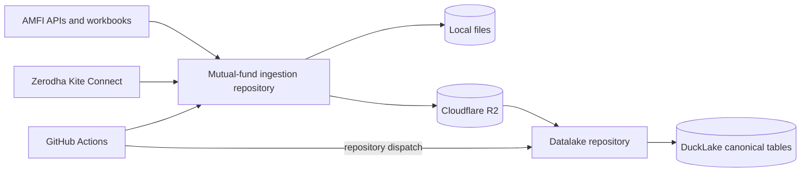
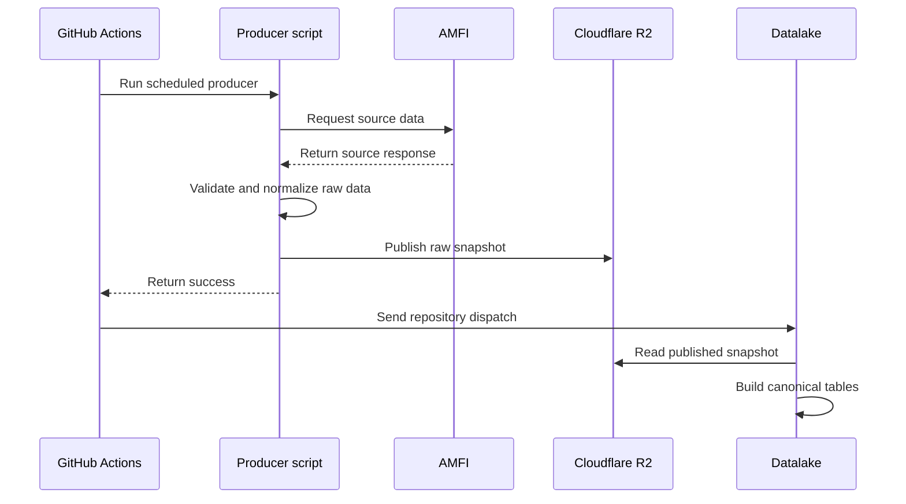

# Architecture

## Purpose and Scope

This repository collects raw Indian mutual-fund data.
AMFI is the primary source.
Zerodha provides one optional instrument source.

The repository publishes reproducible source snapshots.
It does not own the canonical analysis layer.
The separate datalake repository owns canonical tables, validation, and modelling.

## System Context



## Repository Responsibilities

The repository owns these responsibilities:

- Source discovery and download.
- Source response validation.
- Raw field normalization where the source format requires it.
- Immutable raw snapshot publication.
- Source provenance and manifest publication.
- Scheduled producer workflows.
- Datalake dispatch after successful publication.
- Local metadata and master-data maintenance.

The repository does not own these responsibilities:

- Canonical NAV tables.
- Canonical market-cap models.
- Cross-source business validation.
- NIFTY benchmark ingestion.
- Consumer-facing analytics tables.

## Main Components

| Component | Responsibility |
| --- | --- |
| `scripts/` | Source ingestion, transformation, repair, and diagnostics |
| `config/settings.py` | Paths, endpoints, retries, credentials, and R2 connections |
| `utils/nav_helpers.py` | Shared NAV cleaning and Parquet writes |
| `utils/logging_setup.py` | Shared file and console logging |
| `.github/workflows/` | Scheduled production execution and datalake dispatch |
| `data/` | Gitignored local source and processed artifacts |
| Cloudflare R2 | Operational raw snapshot storage |
| Datalake repository | Canonical ingestion, validation, and modelling |

## Storage Architecture

Production workflows use this R2 root:

```text
r2://financial-data-store/mutual_funds/
```

| Area | Contents |
| --- | --- |
| `raw/` | Historical, daily, and repair NAV Parquet |
| `metadata/` | Dated raw scheme metadata |
| `amc_members/` | Immutable member snapshots |
| `aum/` | Dated scheme-wise AUM snapshots |
| `ter/` | Immutable monthly TER snapshots |
| `market_cap/source/` | Original workbooks and provenance manifests |
| `market_cap/raw/` | Values-only workbook snapshots |

`config.settings.R2` creates all R2 paths.
Scripts must not hardcode the bucket root.

Local files support backfills, metadata maintenance, and analysis.
They do not prove current production state.

## Production Data Flow



A producer failure stops its datalake dispatch.
Each scheduled workflow runs independently.
No workflow orchestrates every data product.

## NAV Architecture

Daily NAV extraction discovers the latest canonical daily raw object.
It then fetches later weekdays through yesterday.

Only `nav_daily_<YYYYMMDD>.parquet` objects define the daily watermark.
The fetch loop stops when one date fails.
This rule prevents a later object from hiding a date gap.

NAV repair handles late AMFI reports inside existing daily snapshots.
It publishes only missing scheme and date keys.
It never overwrites a daily snapshot.
Repair objects do not change watermark discovery.

The datalake builds these canonical tables:

- `mf.nav_daily`
- `mf.nav_daily_open_growth`

The datalake also owns NAV freshness and completeness validation.

## Metadata Architecture

Metadata has two separate flows.

The scheduled flow publishes dated raw Parquet to R2.
The local flow reads local CSV files and builds local processed data.

```text
Scheduled: AMFI -> extract_scheme_metadata -> R2 metadata snapshot

Local: local metadata CSV -> clean_scheme_metadata -> build_scheme_masterdata
```

The scheduled extractor does not feed the local cleaner.
No workflow rebuilds local scheme master data.

## Market-Cap Architecture

Market-cap ingestion has two ordered producer stages.

1. The archive stores each original workbook and its provenance manifest.
2. The transform verifies each pair and publishes values-only Parquet.

Changed source bytes create a new immutable revision.
The archive keeps old revisions.
The transform preserves source row values and structural provenance.

Business validation and canonical modelling belong to the datalake.

## Technology Responsibilities

| Technology | Use |
| --- | --- |
| Python modules | Pipeline entry points and source logic |
| Pandas | API responses and local transformations |
| DuckDB | R2 access, SQL checks, and Parquet writes |
| PyArrow | Market-cap Parquet serialization |
| Boto3 | R2 source object and manifest operations |
| GitHub Actions | Scheduling and datalake dispatch |

Historical NAV transformation concatenates every local CSV with Pandas.
It is not a streaming transformation.

## Design Rules

- Raw production objects remain immutable.
- Source responses remain reproducible inputs.
- Scheme codes remain strings.
- Processed data uses Parquet unless an existing flow requires CSV.
- Credentials come from environment variables or `.env`.
- Secret values never enter logs or Git history.
- Production state comes from R2 and canonical datalake tables.

## Current Boundaries

- Scheduled metadata does not feed local metadata maintenance.
- Historical NAV transformation can require substantial memory.
- NAV validation does not gate the producer workflow.
- TER canonical modelling remains outside this repository.
- Local legacy Parquet snapshots are not reproducible with current scripts.
- Legacy clean objects can remain in R2, but current workflows do not read them.

Execution details remain in [PIPELINE_ONBOARDING.md](PIPELINE_ONBOARDING.md).
