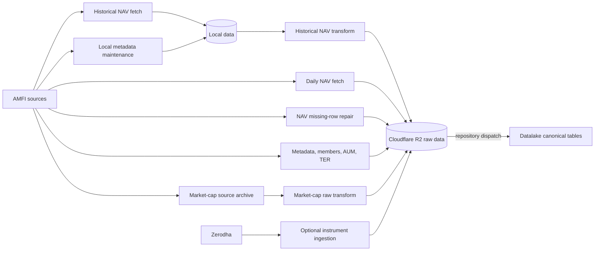

# Pipeline Onboarding

This guide lists every executable script and its required execution order.
Use this guide before running a pipeline manually.

The repository does not have one global pipeline sequence.
Each data product has its own production or maintenance flow.

## Pipeline Map



The datalake dispatch occurs only in scheduled workflows.
Manual commands do not dispatch unless this guide states otherwise.

## Prerequisites

Run commands from the repository root.

1. Install the repository dependencies.
2. Create the required local directories.
3. Configure R2 credentials for R2-backed commands.

```bash
python -c "from config.settings import initialize_project; initialize_project()"
```

Required R2 variables:

```text
R2_ACCESS_KEY_ID
R2_SECRET_ACCESS_KEY
R2_ACCOUNT_ID
```

## Script Inventory

| Script | Purpose | Mode |
| --- | --- | --- |
| `fetch_historical_nav.py` | Download historical NAV chunks from AMFI | Manual |
| `transform_historical_nav.py` | Combine local NAV files and publish raw Parquet | Manual |
| `fetch_daily_nav.py` | Publish missing daily NAV snapshots | Scheduled and manual |
| `repair_missing_nav.py` | Publish missing scheme and date rows | Manual |
| `extract_scheme_metadata.py` | Publish raw scheme metadata | Scheduled and manual |
| `clean_scheme_metadata.py` | Clean the latest local metadata CSV | Local manual |
| `build_scheme_masterdata.py` | Update local scheme lifecycle history | Local manual |
| `extract_amc_members.py` | Publish AMFI member records | Scheduled and manual |
| `fetch_aum_data.py` | Publish scheme-wise AUM | Scheduled and manual |
| `fetch_ter_data.py` | Publish monthly TER snapshots | Scheduled and manual |
| `fetch_amfi_mcap_sources.py` | Archive AMFI market-cap workbooks | Scheduled and manual |
| `transform_amfi_mcap_sources.py` | Publish values-only market-cap rows | Scheduled and manual |
| `ingest_zerodha_mf.py` | Publish optional Zerodha instruments | Manual |
| `test_github_actions_setup.py` | Check configuration and connectivity | Diagnostic |

## 1. Historical NAV Backfill

Use this flow for initial history or an explicit historical repair.

```bash
python -m scripts.fetch_historical_nav --start 20060101 --end YYYYMMDD
python -m scripts.transform_historical_nav
```

Execution order:

```text
AMFI historical endpoint
  -> local chunked CSV files
  -> combined Pandas transformation
  -> R2 raw/nav_historical.parquet
```

The fetcher skips existing chunks unless you pass `--force`.
The transformer loads every local CSV file into memory.

## 2. Daily NAV Production

```bash
python -m scripts.fetch_daily_nav
```

The script finds the latest canonical daily raw object.
It fetches later weekdays through yesterday.
It stops on the first failed date.

Use an explicit bootstrap date only when the raw prefix is empty.

```bash
python -m scripts.fetch_daily_nav --bootstrap-date YYYYMMDD
```

Use `--date YYYYMMDD` for one explicit date.
The scheduled workflow dispatches successful raw uploads to the datalake.

## 3. Missing NAV Repair

Use this flow for reports that AMFI published after an existing daily snapshot.
First run a dry check.

```bash
python -m scripts.repair_missing_nav --start YYYYMMDD --end YYYYMMDD
```

Then review the summary and publish missing rows.

```bash
python -m scripts.repair_missing_nav --start YYYYMMDD --end YYYYMMDD --write
```

The script writes only absent scheme and date keys.
It reports and skips changed NAV values.
Repair objects do not advance the daily watermark.

After publication, run the datalake NAV workflow manually.

```bash
gh workflow run mf-daily.yml --repo raro123/datalake
```

## 4. Scheme Metadata

The scheduled raw flow runs one command.

```bash
python -m scripts.extract_scheme_metadata
```

It writes a dated raw Parquet object under `mutual_funds/metadata/`.

The local maintenance flow has a separate source and sequence.

```bash
python -m scripts.clean_scheme_metadata
python -m scripts.build_scheme_masterdata
```

The cleaner reads the latest local metadata CSV.
The scheduled R2 extractor does not create that local CSV.

## 5. AMC Members

```bash
python -m scripts.extract_amc_members
```

The script publishes one immutable AMFI member snapshot.
The scheduled workflow dispatches the snapshot to the datalake.

## 6. Scheme-wise AUM

The quarterly workflow runs the default command.

```bash
python -m scripts.fetch_aum_data
```

Manual selections are also available.

```bash
python -m scripts.fetch_aum_data --years 3
python -m scripts.fetch_aum_data --fy 1 --period 1
```

The script writes a dated local Parquet file and an R2 snapshot.
The scheduled workflow dispatches the R2 snapshot to the datalake.

## 7. TER

Use one month for a manual snapshot.

```bash
python -m scripts.fetch_ter_data --month YYYY-MM
```

Use an inclusive range for a historical backfill.

```bash
python -m scripts.fetch_ter_data --start-month 2020-04 --end-month YYYY-MM
```

The scheduled workflow uses `--scheduled`.
It publishes required recent months and dispatches successful snapshots.

## 8. Market-Cap Sources and Raw Rows

Always run the archive before the transform.

```bash
python -m scripts.fetch_amfi_mcap_sources
python -m scripts.transform_amfi_mcap_sources
```

Execution order:

```text
AMFI categorisation page
  -> immutable source workbook and manifest pairs
  -> verified values-only raw Parquet
  -> datalake dispatch from the scheduled workflow
```

The archive retains changed workbook revisions.
The transform reads only complete and verified source pairs.
Any scheduled failure stops the datalake dispatch.

## 9. Optional Zerodha Instruments

```bash
python -m scripts.ingest_zerodha_mf
```

This script requires Kite Connect credentials.
It does not belong to an automated workflow.

## 10. Environment Diagnostic

```bash
python -m scripts.test_github_actions_setup
```

This command can access R2 and AMFI.
It is not a unit-test command.

## Automated Flow Order

The scheduled data products run independently.
Only these workflows have internal multi-step order:

1. Market-cap archive, transform, and datalake dispatch.
2. Each raw producer and its later datalake dispatch.

Historical backfills, NAV repairs, and local metadata maintenance remain manual.
See [GITHUB_ACTIONS_SETUP.md](GITHUB_ACTIONS_SETUP.md) for schedules and secrets.

## Retired Local Outputs

No current script rebuilds these local files:

- `data/processed/nav_combined/raw_nav_table.parquet`
- `data/processed/analytical/nav_daily_data.parquet`

Treat them as historical snapshots.
Use canonical datalake tables for current NAV analysis.
